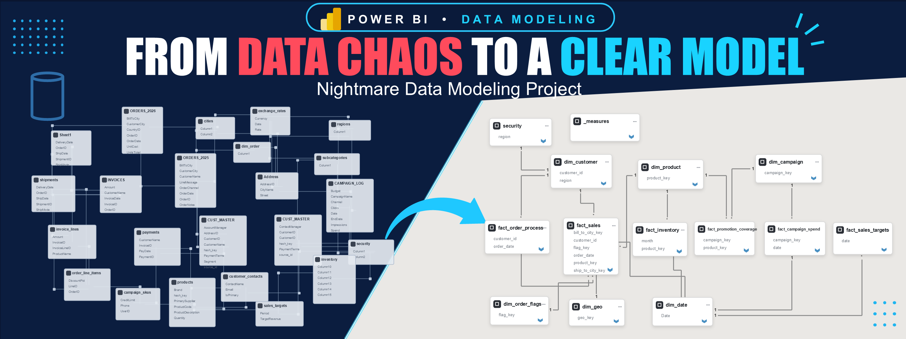
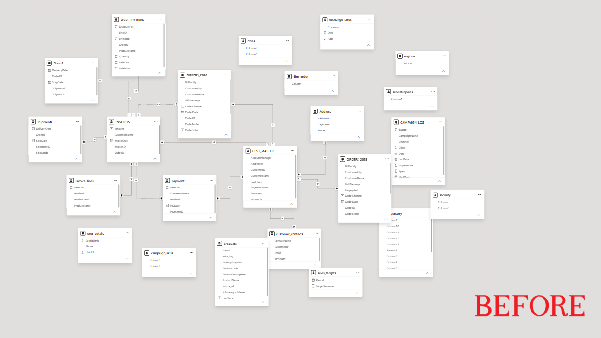
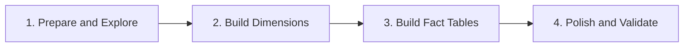
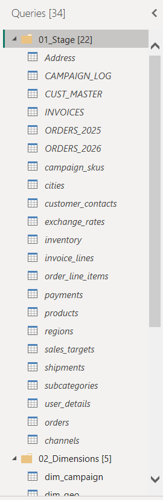
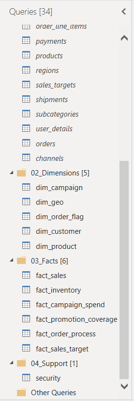
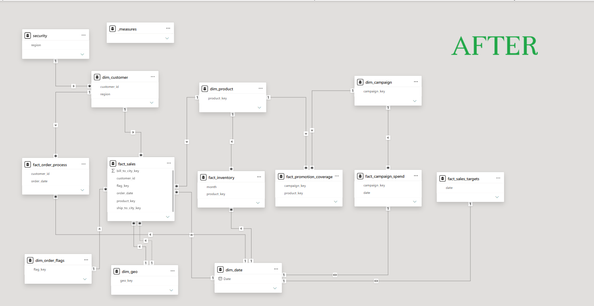
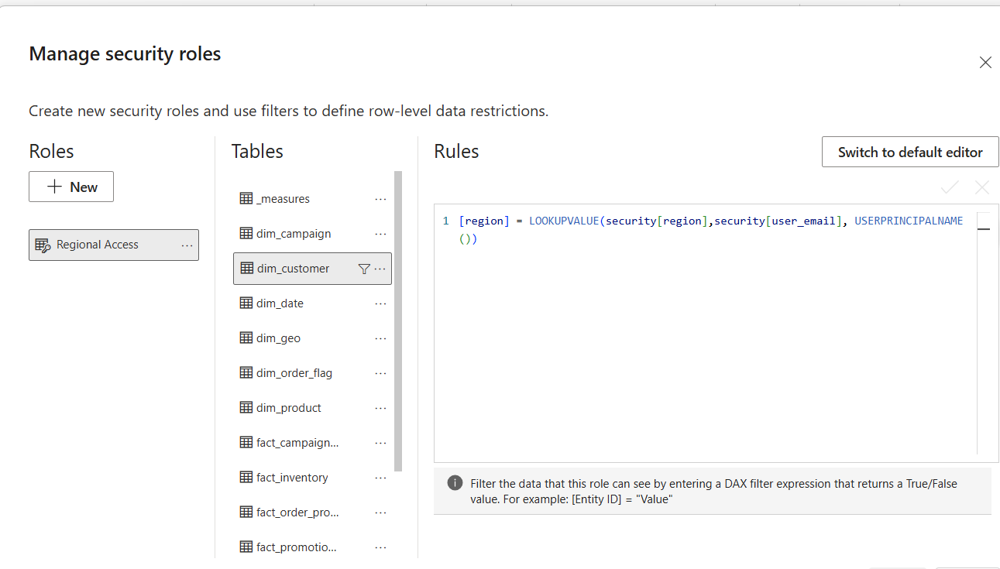
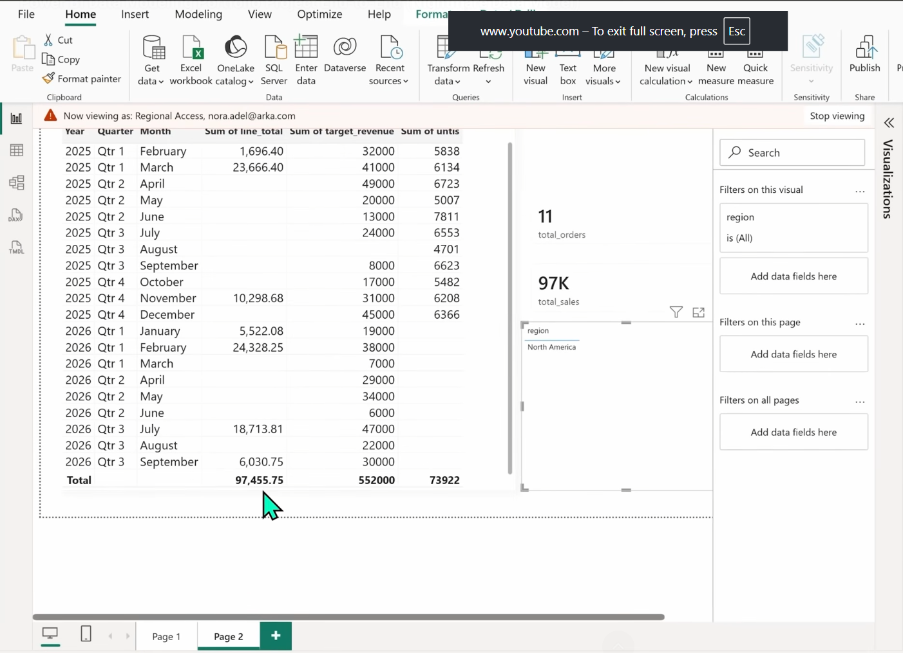

<p align="center">
  
</p>

# Power BI Nightmare Data Modeling Project

**From 23 messy source tables to a star-schema model with regional row-level security.**

> 📌 **Project type: guided learning project.** I followed Baraa's *Nightmare Data Model* tutorial and built the model step by step in Power BI. The dataset and business scenario come from the tutorial. This is not a real company model and it has not been deployed anywhere. Details are in [Assumptions, limitations and trade-offs](#assumptions-limitations-and-trade-offs).

## At a glance

| | |
|---|---|
| **Starting point** | A Power BI model with 23 source tables, tangled relationships and no clear fact or dimension structure |
| **Goal** | A clean star-schema model that is easy to understand, easy to maintain, and safe to report from |
| **Result** | 6 dimension tables, 6 fact tables, a measures table and a security table, with consistent naming |
| **Main techniques** | Dimensional modeling, Power Query reshaping, grain checks, total checks after changes, row-level security |
| **Tools** | Power BI Desktop, Power Query, DAX |
| **Not in scope** | A finished business dashboard or business findings |

## Contents

- [Project overview](#project-overview)
- [Objectives](#objectives)
- [Tools used](#tools-used)
- [The problem: before modeling](#the-problem-before-modeling)
- [Modeling workflow](#modeling-workflow)
- [Modeling standards](#modeling-standards)
- [The final data model](#the-final-data-model)
- [Validation and quality checks](#validation-and-quality-checks)
- [Row-level security](#row-level-security)
- [Lessons learned](#lessons-learned)
- [Recommendations for future work](#recommendations-for-future-work)
- [Assumptions, limitations and trade-offs](#assumptions-limitations-and-trade-offs)
- [Repository structure](#repository-structure)
- [How to explore this project](#how-to-explore-this-project)
- [Skills demonstrated](#skills-demonstrated)
- [Author](#author)

---

## Project overview

The project starts with a deliberately messy Power BI model: 23 source tables, relationships going in every direction, and no obvious fact or dimension tables. The task is to turn it into a clean star schema.

A weak data model usually does not fail loudly. It produces confusing relationships, rows that are counted twice, measures that disagree with each other, and a model that is hard for anyone else to maintain. Reports built on top of it can look fine and still show wrong numbers.

This project is about the model underneath the reports. It does not include a finished dashboard, and it makes no claims about business performance. The work is in understanding the source tables, deciding what is a fact and what is a dimension, connecting them correctly, and checking that the numbers stay the same while the structure changes.

## Objectives

- Understand what each source table represents and what one row means (its grain).
- Separate fact tables from dimension tables.
- Build a star schema where fact tables connect to shared dimensions, never directly to each other.
- Use one naming standard for tables and columns.
- Remove columns that do not earn their place in the model.
- Check totals and duplicates after every structural change.
- Add a date dimension and a small set of core measures.
- Restrict data by region with row-level security.

## Tools used

- **Power BI Desktop** for the model view, relationships, report view checks and the "View as" security test.
- **Power Query** for reshaping source tables: references, merges, appends, unpivot, splitting columns, grouping for checks, and manually entered mapping data.
- **DAX** for the date dimension (`CALENDARAUTO`), a calculated column, the measures table, and the row-level security filter.

## The problem: before modeling

This is the original model before any changes. Most of the tables are linked to each other in a web of relationships, with many-to-many links and filter directions going both ways.



*Before: no star schema, no clear fact or dimension tables, and relationships that make it hard to know which table filters which.*

Going through the source tables in the tutorial exposed typical problems, for example:

- The same entity described in several tables (customer data was spread over six tables, and the source used both "customer" and "user" for the same thing).
- One table split in two by year (orders for 2025 and 2026) and one table imported twice (shipments).
- Order headers and order lines in separate tables, with different grains.
- Dates stored as column names (inventory by month), and several values packed into one cell (category and subcategory joined by a pipe, product codes stored as a comma-separated list).
- Technical codes with no meaning to a report reader (order channel as 10, 20, 30, 40).
- Test records, such as a dummy customer and a dummy product, plus a junk table with a single column of IDs.

## Modeling workflow

The work followed four phases.



### Phase 1: Prepare and Explore

Understand the business, inspect the messy model, prepare the workspace, explore the source data, and identify likely fact and dimension tables.

I went through all 23 tables, asked what each row represents, and marked likely dimensions (customers, products, geography) and likely facts (orders, invoices, payments, shipments, campaigns, inventory, targets). Before changing anything, I organized Power Query into groups so raw tables and new tables would not get mixed up.





*Power Query organization: raw source queries stay in a staging group, new dimensions and facts go into their own groups, and anything that is neither (such as the security table) goes into a support group. The default "Other Queries" group is left for new sources that have not been looked at yet.*

### Phase 2: Build Dimensions

Group related tables by business entity, reshape them into clean dimensions, and apply consistent naming and data-cleaning standards.

The loop was the same each time: pick the tables that describe one entity, work on a reference of the main table (so the raw data stays untouched), merge in the rest with left joins, check that the row count did not change, then clean and rename. `dim_customer` and `dim_product` came from master tables. Other dimensions, such as the order flags and the campaign dimension, were extracted from event tables.

### Phase 3: Build Fact Tables

Identify the grain of each business event, build the fact tables from the appropriate details, connect them to dimensions, and validate the numbers.

For orders, the fact table was built from the order line items, because that is where the numbers are. The order header was used for context and for the keys. After each merge I compared the total against the number I was protecting. One merge failed that check and had to be fixed (see [Lessons learned](#lessons-learned)).

### Phase 4: Polish and Validate

Recheck standards, add the date dimension and measures, configure row-level security, and perform final validation.

This phase covered a naming and format review, the date dimension, a small measures table, the regional security role, and report-level checks that totals and filters behave as expected.

## Modeling standards

These are the standards set at the start of the tutorial and followed throughout. They are the conventions used in this project, not universal rules.

| Standard | Rule | Example |
|---|---|---|
| Language | Use English | `customer_name` |
| Naming | Use snake_case | `order_date` |
| Table prefixes | `fact_` for facts, `dim_` for dimensions | `fact_sales`, `dim_customer` |
| Key suffixes | `_key` for keys created in the model, `_id` for identifiers from the source | `product_key`, `customer_id` |
| Friendly names | Prefer descriptive names over technical or cryptic ones | `cities.region_name` became `region` |
| Column selection | Keep only columns that serve a purpose | Hash keys, long descriptions and legacy columns removed |
| Data grain | Understand what one row represents before changing or combining tables | Check grain before merging contacts into customers |
| Star schema | Facts connect to dimensions, never to other facts | Facts share `dim_product` and `dim_date` |
| Validation | Recheck totals after every change | Compare the same total before and after a merge |

Other practices shown in the tutorial and applied in the model: left joins for lookups so no rows are lost, one place for each piece of information, removing pre-aggregated values that can be calculated from detail rows, capitalized text values, one short date format, and turning off default summarization on numeric columns that should not be summed.

## The final data model

The final model is a star schema with several fact tables that share dimensions. Every relationship goes from a dimension to a fact table.



*After: dimensions surround the facts, fact tables do not connect to each other, and the measures and security tables sit beside the model.*

### Dimensions

| Table | Role | Built from |
|---|---|---|
| `dim_customer` | One row per customer, with segment, payment terms, credit limit, contact, address and region | Customer master, merged with contacts, user details, addresses and cities |
| `dim_product` | One row per product, with subcategory and category | Products and subcategories |
| `dim_order_flag` | Junk dimension holding order channel, status and priority combinations (14 rows) | Extracted from the combined orders table |
| `dim_geo` | City and region, used for shipping and billing locations | Cities |
| `dim_campaign` | Campaign name, channel, start date, end date and budget (6 campaigns) | Campaign log |
| `dim_date` | Calendar table generated from the date range in the model (January 2025 to the end of 2026 in the tutorial data) | `CALENDARAUTO()` in DAX |

### Facts

| Table | What one row represents | Connects to |
|---|---|---|
| `fact_sales` | One order line | `dim_customer`, `dim_product`, `dim_order_flag`, `dim_geo` (twice), `dim_date` |
| `fact_inventory` | Stock units for one product in one month | `dim_product`, `dim_date` |
| `fact_campaign_spend` | Daily activity for one campaign: impressions, clicks, spend | `dim_campaign` |
| `fact_promotion_coverage` | One campaign-product pair (a factless fact with no measures) | `dim_campaign`, `dim_product` |
| `fact_order_process` | One order, with the dates of each process step (order, shipment, delivery, invoice, payment) | `dim_customer`, `dim_date` |
| `fact_sales_target` | Target revenue for one month | `dim_date` |

### Supporting tables

| Table | Role |
|---|---|
| `_measures` | An empty table that holds the core measures in one place |
| `security` | Maps user identities to regions for row-level security |

Some notes on the design:

- **`dim_geo` is used twice by `fact_sales`**, once for the ship-to city (the active relationship) and once for the bill-to city (inactive). Using the inactive one requires a DAX measure.
- **`fact_order_process` is an accumulating snapshot.** Instead of one fact table for each of orders, shipments, invoices and payments, it keeps one row per order with all the step dates. The money is already in `fact_sales`, so the other tables would only repeat it.
- **Several source tables were left out on purpose** (exchange rates, invoices, invoice lines, payments and shipments were disabled from loading, and two junk tables were deleted). They can be brought back if a real question needs them.

More detail on why each choice was made is in [docs/modeling-decisions.md](docs/modeling-decisions.md).

## Validation and quality checks

The tutorial treats the model's totals as something to protect. Pick one important number, note it, and make sure it does not change when the structure changes.

### Checks shown in the tutorial

| Check | Where it was used | What it showed |
|---|---|---|
| Ask what one row represents before merging | Customers and contacts, orders and order lines | Contacts have a different grain than customers, so a plain merge duplicated customers |
| Count rows after a merge | `dim_customer` after each merge | The customer count must stay at 60 after removing the test customer (it was 61) |
| Group by the key and count rows | Customer ID, product names, order IDs | Quick way to spot duplicates |
| Check relationship cardinality in the model view | Before merging addresses and cities into the customer dimension | A one-to-one or one-to-many link from the lookup table means the merge is safe |
| Compare a total before and after each merge | `fact_sales` line total | Caught a merge on product name that inflated sales because two products shared a name |
| Check relationship direction | Every dimension-to-fact link | One-to-many, single direction, from dimension to fact |
| Test security with "View as" | `regional_access` role | Totals and regions shrink to one region for the test user, and return to full when the test stops |
| Compare facts side by side through `dim_date` in a report | Phase 4 | Total sales stayed unchanged while inventory and target figures were added to the same visual |

### Recommended additions (not part of the tutorial, not claimed as done)

- Keep a written list of the protected totals and re-run them after every change.
- Test the security role with more than one user identity, including a user who is not in the security table.
- Document the grain, key and relationships of every table.

A checklist version of this section is in [docs/validation-checklist.md](docs/validation-checklist.md). This project does not include automated tests.

## Row-level security

The model is restricted by region. A `security` table lists user identities and the region each one may see. The security table has a one-to-many, single-direction relationship to `dim_customer` on region, so it filters the customer dimension, and the customer dimension filters the facts.

I secured through `dim_customer` because it filters two fact tables (`fact_sales` and `fact_order_process`). `dim_geo` also holds region, but it only filters `fact_sales`. Products were left unrestricted because showing every product to every user was not seen as a problem.

A role named `regional_access` is defined on `dim_customer`. Its filter keeps a customer row only when the customer's region matches the region assigned, in the security table, to the user who is opening the report. The user's identity comes from the DAX function `USERPRINCIPALNAME()`.



*Configuration: the role and its filter on `dim_customer`.*



*Testing: with "View as" turned on for a sample user, the totals and the region list shrink to that user's region.*

This was configured and tested in Power BI Desktop. Publishing the model, assigning real users to the role in the Power BI service, and testing there were not part of the tutorial and are not covered here. The identities used in the tutorial are sample values.

## Lessons learned

These are the lessons that stood out while building the model.

1. **Check the grain before combining tables.** Customers have one row per customer, but contacts have several rows per customer. Merging them directly turned 60 customers into many more rows. The fix was to bring in only the primary contact, then confirm that the key was unique.
2. **A lookup on text can quietly duplicate fact rows.** Looking up the product key by product name made total sales go up, because two products shared a name and had different keys. Comparing the total after the merge caught it. The duplicates were removed in the model, although in a real project the better fix is at the source.
3. **Build the fact at the level where the numbers are.** For orders, the lines hold the quantities and amounts, and the header holds context. Building the fact from the lines and using the header for keys avoids two related fact tables joined to each other. Counting orders then needs a distinct count, because an order appears on several lines.
4. **Whether something is a fact or a dimension depends on what it does, not on whether it has dates and numbers.** The campaign start date and budget describe the campaign, so they went into the dimension. The daily clicks and spend are events, so they went into the fact.
5. **Security follows the model, and has to be tested.** Putting the security filter on `dim_customer` protected two fact tables with one role, and the "View as" test confirmed it. The role is only as good as the identities in the security table.

## Recommendations for future work

These are suggestions for a project like this. They are not completed deliverables.

- Re-test row-level security with several user identities, including one that is missing from the security table.
- Document the cardinality and filter direction of every relationship.
- Document the grain of every fact table in one place.
- Keep a repeatable validation checklist and record the protected totals.
- Measure refresh time and file size before and after cleanup before making any performance claim.
- Replace the hand-entered channel mapping with a mapping provided by the source system, or assign someone to maintain it.
- Add a short guide for report builders: how the star schema is laid out and which measures to use.

## Assumptions, limitations and trade-offs

- **This is a guided learning project.** The tutorial author provided the dataset, the scenario and the teaching approach. The modeling workflow and implementation in this repository are my own completed learning work, and the repository does not claim to reproduce or replace the original teaching material.
- **No real-world deployment.** The model was not built for or used by a company, and nothing here describes business results.
- **Choices depend on requirements.** The decisions reflect this scenario and its source data. Another business question could justify a different model, for example a separate address dimension, or invoice and payment facts.
- **Some trade-offs were made on purpose:**
  - Customer and address data were merged into one dimension (star schema) rather than split into a snowflake.
  - Several event tables were left out, because their numbers repeat what is already in `fact_sales`.
  - The order process fact keeps dates only, so questions about invoice or payment amounts would need another fact table.
  - `dim_geo` is used twice by `fact_sales`, which is cleaner than duplicating data but needs DAX for the inactive relationship.
  - `fact_promotion_coverage` is a factless fact that the tutorial itself describes as an unusual case, and it could be removed if it is not needed.
  - The channel names come from a small table entered by hand. If the source starts sending new codes, the mapping has to be updated or reports will show blanks.
  - Duplicate product rows were removed in the model instead of being fixed in the source system.
- **Limited validation.** Checks were done by hand and are listed above. There was no automated testing.
- **Security is configured only in Power BI Desktop.**

## Repository structure

```text
powerbi-nightmare-data-modeling/
├── README.md
├── docs/
│   ├── modeling-decisions.md
│   └── validation-checklist.md
└── images/
    ├── cover.png
    ├── before/
    │   └── messy_data_model.png
    ├── after/
    │   └── final_data_model.png
    ├── workflow/
    │   ├── query_organization_1.png
    │   └── query_organization_2.png
    └── security/
        ├── rls_configuration.png
        └── regional_access_example.png
```

## How to explore this project

1. Read this README from top to bottom, or use the table in [At a glance](#at-a-glance) for the short version.
2. Compare [the original model](#the-problem-before-modeling) with [the final model](#the-final-data-model).
3. Read [docs/modeling-decisions.md](docs/modeling-decisions.md) for the reasoning behind each choice.
4. Use [docs/validation-checklist.md](docs/validation-checklist.md) to see which checks were done and which are suggested.

The Power BI file (`.pbix`) is not included in this repository, so everything above can be reviewed through the screenshots and documentation without installing anything.

**Source and credit.** The dataset, scenario and method come from Baraa's Nightmare Data Model project, part of his free Power BI data modeling course. His announcement post is here: [The Nightmare Data Model Project](https://www.blog.datawithbaraa.com/p/the-nightmare-data-model-project). All credit for the original tutorial belongs to him.

## Skills demonstrated

- Power BI data modeling
- Power Query (merge, append, unpivot, split, reference queries)
- Dimensional modeling and star-schema design
- Fact and dimension table design, including a junk dimension, an accumulating snapshot and a factless fact
- Relationship design (cardinality, filter direction, role-playing dimensions)
- Data quality checks and validation
- Date dimension and core measures in DAX
- Row-level security
- Technical documentation

## Author

**Arao Zau Macaia**
Data Analyst who helps businesses make data-driven decisions.


<p align="left">
  <a href="https://github.com/araomacaia" target="_blank">
    
  </a>
  &nbsp;
  <a href="https://www.linkedin.com/in/araomacaia/" target="_blank">
    
  </a>
  &nbsp;
  <a href="mailto:araomacaia718@gmail.com">
    
  </a>
</p>
